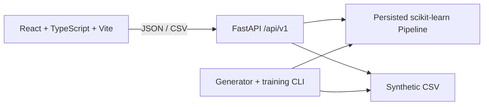

# SEGONE Credit Risk Intelligence

**Understand Risk. Explain Decisions. Engineer Confidence.**

An educational credit-risk analytics demonstration powered entirely by reproducible synthetic applications. It is not a validated lending model and must not be used to approve or reject actual loans.

## Features and implementation status

- Synthetic generator with numeric/categorical features, controlled missingness, correlated inputs, cohort and stochastic binary outcomes: implemented.
- Logistic Regression and Random Forest training; XGBoost added when its dependency is installed. Validation ROC-AUC selects the persisted demonstration pipeline; untouched test split is used for final reporting: implemented.
- FastAPI prediction, metadata, portfolio summary/records/distributions/CSV, model metrics and data profile: implemented.
- React overview, records, assessment, model evaluation, data profile and methodology pages wired to API: implemented.
- Local SHAP explanations, rich interactive chart suite, full filter controls, frontend automated tests and calibration: not yet implemented. Explainability explicitly returns unavailable; no explanation is fabricated.
- Docker and CI configuration included but not verified in this environment.

## Architecture



## Local setup (Python 3.11–3.13 and Node 22 recommended)

From repository root, use two terminals:

```powershell
py -3.12 -m venv .venv
.\.venv\Scripts\Activate.ps1
python -m pip install -r backend/requirements.txt
python -m backend.app.ml.data_generator --n 12000 --output data/applications.csv
cd backend
python -m app.ml.train
uvicorn app.main:app --reload
```

In the other terminal:

```powershell
cd frontend
npm install
npm run dev
```

Open http://localhost:5173. The backend defaults to http://localhost:8000. Set `VITE_API_BASE_URL` at frontend build time and `CORS_ORIGINS` on the API. Regenerate with a fixed `--seed` (default 42); retrain by running `python -m app.ml.train` from `backend`.

## API example

`POST /api/v1/predictions` accepts all canonical fields: `annual_income`, `loan_amount`, `interest_rate`, `loan_term_months`, `employment_tenure_years`, `debt_to_income`, `existing_obligations`, `previous_delinquencies`, `credit_history_years`, `loan_purpose`, and `employment_category`. Categories are `debt_consolidation|home_improvement|medical|education|vehicle` and `salaried|self_employed|contract|part_time`.

Example synthetic request:

```json
{"annual_income":720000,"loan_amount":180000,"interest_rate":14.5,"loan_term_months":36,"employment_tenure_years":5,"debt_to_income":0.31,"existing_obligations":98000,"previous_delinquencies":0,"credit_history_years":8,"loan_purpose":"debt_consolidation","employment_category":"salaried"}
```

The response includes a probability generated by the locally persisted model, model version, illustrative band, timestamp, explanation availability and disclaimer. Values vary with trained artifacts; no sample score is asserted here.

## Evaluation and limits

Training reserves a stratified test split before preprocessing; preprocessing is fitted inside model pipelines on training data. Candidate choice uses validation ROC-AUC, then the selected candidate is refit on train+validation. Evaluation metadata contains validation metrics and a final holdout report for the selected candidate; threshold is 0.5. The probabilities are uncalibrated and synthetic. ROC-AUC measures ranking, not probability reliability or real-world performance. See [docs/methodology.md](docs/methodology.md), [docs/data_dictionary.md](docs/data_dictionary.md), [docs/responsible_ai.md](docs/responsible_ai.md), [docs/deployment.md](docs/deployment.md).

## Checks

```powershell
cd backend; pytest
cd ..\frontend; npm run lint; npm run typecheck; npm test; npm run build
```

## Docker

Generate and train artifacts locally first, then `docker compose up --build`. The generated CSV and model are ignored by Git and mounted into the API container.

## Deployment

The repository includes a Render Blueprint for the API and supports Cloudflare Pages for the frontend. The API Docker image trains its reproducible synthetic model during the image build. Follow [docs/deployment.md](docs/deployment.md) to create both services and connect their URLs. The repo is deployment-ready, but no cloud deployment has been performed; viewers need the resulting Pages URL after the services are created.

## Roadmap

SHAP contributions in a verified probability-consistent output scale; responsive chart exploration; complete filter parity and export; calibration analysis; fairness audit on explicitly synthetic audit attributes; expanded API/frontend tests; deployment verification.

## Screenshots

Capture overview, filtered portfolio, assessment result, model comparison and mobile navigation after local startup. No screenshots are included yet.
